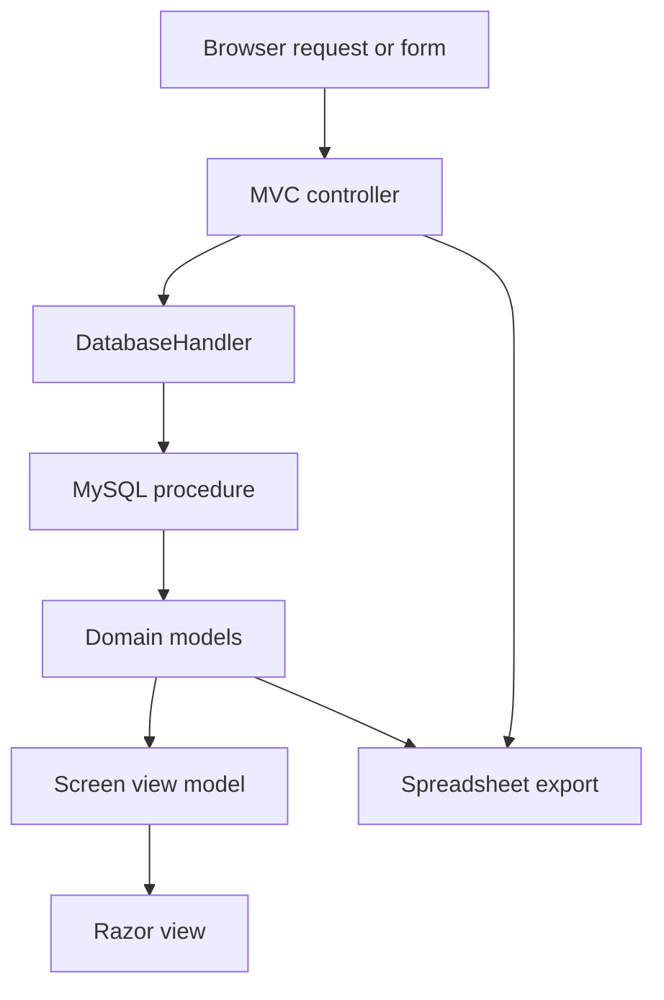

# Online Banking Coursework: MVC, Data, and Reporting: project walkthrough

[Overview](../README.md) · [Code reference](CODE_REFERENCE.md) · [Development guide](DEVELOPMENT.md)

## Attribution and scope

This is CS451 Group 6 coursework. It includes contributions from a team, not an individually authored commercial banking product. The [historical team repository](https://github.com/umkc-cs-451-2019-fall/semester-group-assignment-group-6) supplies additional context where accessible.

## Repository layers

| Path | Role |
| --- | --- |
| [Online Banking/asp-core-mvc.sln](../Online%20Banking/asp-core-mvc.sln) | Solution entry point |
| [Controllers](../Online%20Banking/asp-core-mvc/Controllers) | Request handling, session checks, view-model construction, form actions |
| [Models](../Online%20Banking/asp-core-mvc/Models) | Account/transaction/rule/report objects and `DatabaseHandler` |
| [ViewModels](../Online%20Banking/asp-core-mvc/ViewModels) | Data assembled for individual screens |
| [Views](../Online%20Banking/asp-core-mvc/Views) | Razor templates, shared layouts, and screen-specific forms/tables |
| [Database](../Database) | SQL source, schema/relationship artifacts |
| [Documentation](../Documentation) | Original team architecture, planning, requirements, guides, and test documents |
| [Paper Prototypes.pdf](../Paper%20Prototypes.pdf), [Website Prototypes.pdf](../Website%20Prototypes.pdf) | Historical UI design artifacts |

## Request flow

`Program.Main` starts the web host. `Startup` configures MVC, session state, cookie behavior, and the conventional controller/action route; the default landing controller is Login. A successful `LoginController.Login` stores the customer ID and displayed name in session. Screen controllers typically check the session before building their view model. This describes the normal flow, not a guarantee of complete authorization coverage.

## Controllers and screen objects

| Controller | Main responsibilities |
| --- | --- |
| `LoginController` | Render login, validate supplied credentials through the database handler, populate/clear session |
| `HomeController` | Assemble selected-account balance, alerts, and transactions |
| `TransactionsController` | Assemble transaction history for the selected account |
| `AlertsController` | Assemble visible alerts and request alert removal |
| `RulesController` | Load/edit rule settings, check date ordering, and choose set/delete behavior |
| `ReportsController` | Assemble current/previous summaries and generate an Excel download |

View models carry the account choices, selected account, and the screen's domain data. For example, `RulesModel` contains `accounts`, `curAccount`, and a `Rules` object. A posted account ID selects a screen context; it is not by itself proof that the customer owns that account.

## Database objects and resource lifecycle

`DatabaseHandler` is a static access facade, but it now stores configuration rather than one shared open connection. `SetupConnection` reads `ConnectionStrings:BankDatabase`. Each of the 12 database operations creates its own pooled `MySqlConnection` and disposes the connection, command, and reader through `using` blocks. Nullable start/end dates are checked against `DBNull.Value`.

The operations include `getAccounts`, `getAccount`, `validateUser`, `getTransactions`, `getAlerts`, `exportAlerts`, `getRules`, `setRules`, `deleteRules`, `removeAlert`, `getReports`, and `getPrevReports`. They call stored procedures; this is not an ORM/migration-based implementation.

There are two historical SQL artifacts: [Database/Banking Database.sql](../Database/Banking%20Database.sql) and [Online Banking/cs451_project.sql](../Online%20Banking/cs451_project.sql). Their table names and procedures differ. The former includes the familiar `getAccount`, `getAlerts`, `getRules`, and related procedure names, but compatibility still needs runtime verification. Do not assume importing either file blindly reconstructs a complete working database.

## Follow a report export

`ReportsController.Export` accepts date/account parameters, retrieves prior report summaries and alerts, creates an EPPlus workbook, fills summary cells and alert rows, and returns an XLSX download. This path is separate from normal Razor rendering. Historical reports and planning PDFs are delivery artifacts, not automated evidence that this export currently succeeds.

## Remaining boundaries

The target framework and package stack remain legacy. Some action paths perform database work before their session guard, and per-account authorization, antiforgery protection, password handling, and export/resource behavior need dedicated review. Syntax checks do not establish a successful build, safe deployment, correct stored procedures, or real banking suitability. Use only a dedicated demo database; see [development](DEVELOPMENT.md) for configuration shape without credentials.
